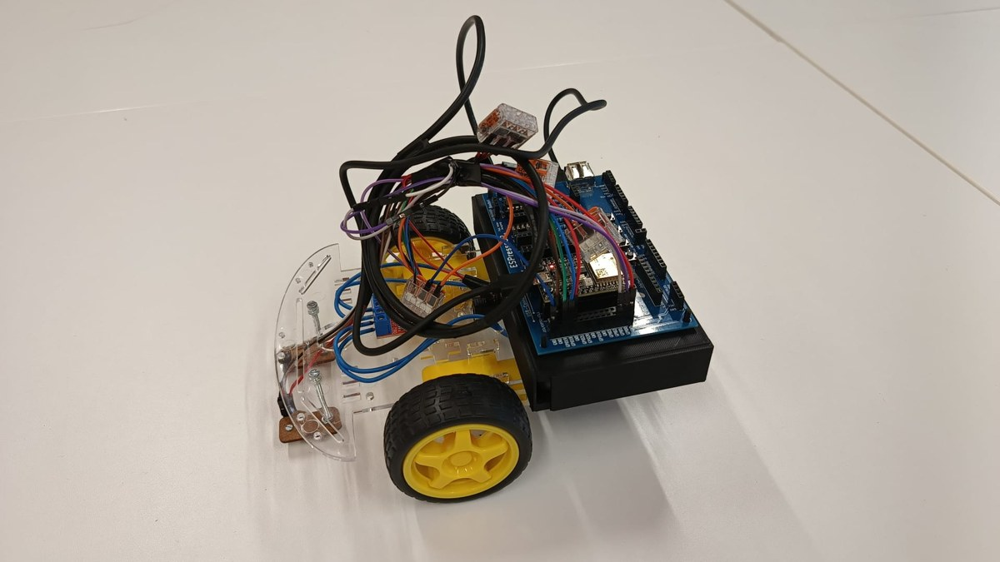

# RoboCar mit ESP32

**Erstsemesterprojekt im Informatikstudium · Embedded Systems · Arduino IDE**

Wir haben im Team ein Roboterauto aufgebaut und einen Prototyp für die Erkennung einer schwarzen Linie entwickelt. Die Fahrlogik prüft zwei analoge Sensoren und stoppt die Motoren, sobald einer der Sensorwerte den festgelegten Schwellwert überschreitet.

## Vom Bausatz zum Prototyp

1. **Aufbau und Verkabelung.** Wir montierten das Robot Car Kit 05 und entwarfen eine Halterung, die Platine und Powerbank senkrecht aufnimmt. Dadurch ließen sich die Komponenten leichter verdrahten.
2. **Motoren einzeln testen.** Für den ersten Test passten wir einen Sketch aus dem ESP32-Workshop an. Anschließend steuerten wir beide Motoren an, sodass das Fahrzeug geradeaus fahren konnte.
3. **Sensorwerte vergleichen.** Im seriellen Monitor beobachteten wir auf dem weißen Tisch Werte von etwa 400 bis 800. Beim Test mit einem schwarzen Strich wurde ein Wert von 4095 gemessen.
4. **Sensoren und Motoren verbinden.** Der zweite Testsketch liest beide Sensoren in jeder Schleifeniteration aus. Liegt mindestens ein Wert über 4000, setzt die Stopproutine die Motorausgänge auf null. Andernfalls steuert der Sketch die Motoren mit einem PWM-Wert von 175 an. Diese Werte beziehen sich auf unseren Versuchsaufbau.

| Halterung und Elektronik | Sensoren am Fahrwerk |
| --- | --- |
|  |  |

## Mein Beitrag

Ich war Teil des Projektteams und habe gemeinsam mit einem Teammitglied den Bausatz beschafft. Aufbau, Verdrahtung und Funktionstests haben wir als Team umgesetzt.

## Projektstand

Dieses Repository dokumentiert den Prototyp als Fallstudie. Grundlage sind die beiden damaligen Projektdokumentationen und die Fotos aus dem Aufbau. In der Dokumentation sind Testsketche zur Motoransteuerung und Linienerkennung enthalten. Bluetooth ist dort als nächster Schritt aufgeführt.
