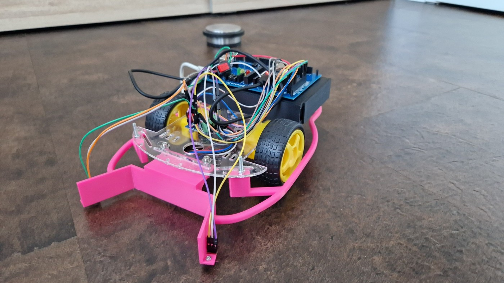
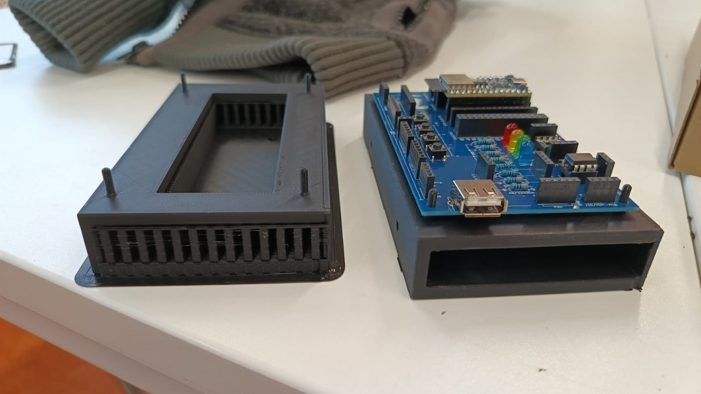
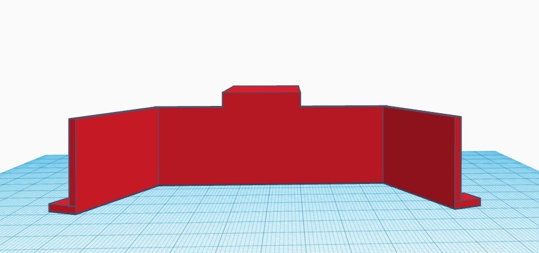
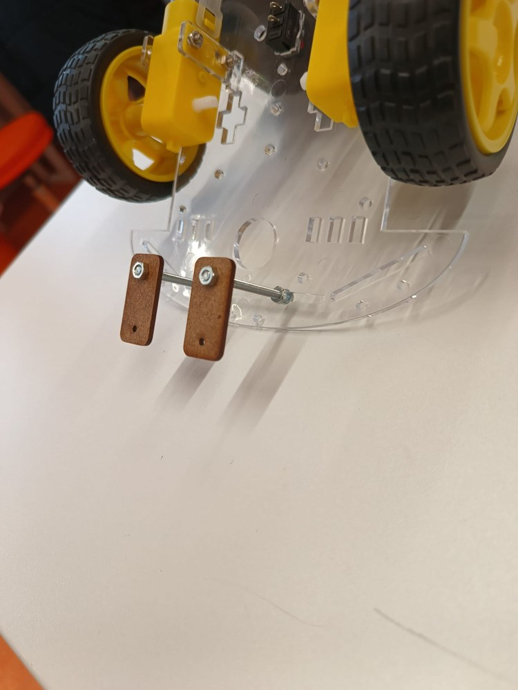
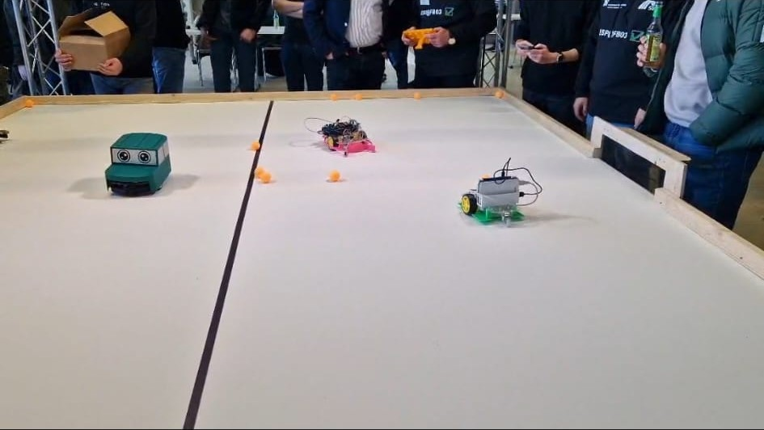

# RoboCar mit ESP32

**Erstsemesterprojekt im Informatikstudium · 2023 · Teamprojekt**

Wir haben ein Roboterauto gebaut, das sich per Handy fernsteuern lässt. Es fährt vorwärts und rückwärts, dreht nach links und rechts und stoppt automatisch, sobald einer der beiden vorderen Sensoren eine schwarze Linie erkennt. Für die Vorführung markierte unser Professor die Linie mit schwarzem Klebeband.

## Mein Beitrag

Ich war für die **mechanische Konstruktion, die Verkabelung und drei 3D-Druckentwürfe** zuständig. Ich baute das Fahrzeug auf Basis des Robot Car Kit 05 auf, verkabelte die Elektronik und modellierte in einem browserbasierten 3D-Werkzeug drei Teile, die am Fahrzeug montiert wurden.

Bei der Halterung für Platine und Powerbank entschieden wir uns im Team nach dem ersten Aufbau für eine andere Anordnung. Die Komponenten konnten damit senkrecht montiert werden, was das Verdrahten erleichterte. Bei der Kabelführung achtete ich darauf, dass keine losen Leitungen an die Räder geraten.

| Halterung und Platine | CAD-Entwurf des Frontaufsatzes |
| --- | --- |
|  |  |

## Von der Motoransteuerung zur Linienerkennung

1. **Motoren testen.** Wir passten in der Arduino IDE einen Sketch aus dem ESP32-Workshop an und steuerten zunächst einen Motor an. Danach testeten wir die Geradeausfahrt mit beiden Motoren.
2. **Sensorwerte messen.** Wir lasen die beiden analogen Sensoren im seriellen Monitor aus. Beim Tischtest lagen die Werte auf der weißen Oberfläche etwa zwischen 400 und 800. Beim schwarzen Strich zeigte der Monitor 4095 an.
3. **Stopp auslösen.** Im dokumentierten Testsketch prüft der ESP32 beide Sensorwerte. Sobald mindestens einer über 4000 liegt, setzt die Stopproutine die Motorausgänge auf null. Der Schwellwert stammt aus unserem Versuchsaufbau.
4. **Fahrzeug vorführen.** Bei der Abschlussvorführung funktionierten die Handy-Fernsteuerung und der automatische Stopp am schwarzen Klebeband.

## Praxistest beim Roboterfußball

Nach dem Projekt traten die Fahrzeuge bei einem freiwilligen Fußballspiel der Hochschule gegeneinander an. Schwarzes Klebeband trennte die Spielfeldhälften. Die Fahrzeuge sollten an dieser Grenze automatisch stoppen und so in ihrer eigenen Hälfte bleiben.

Unser pinker Frontaufsatz war zu kurz, um den Ball gut zu führen. Mit der kurzen Kante mussten wir den Ball mit Schwung in Richtung Tor stoßen. Bei einer nächsten Version würde ich den Aufsatz mit längeren seitlichen Führungen entwerfen und mehrere Formen mit dem tatsächlichen Spielball testen.

## Projektmaterial

Diese Fallstudie basiert auf der damaligen Projektdokumentation, den Projektfotos und meinem Rückblick auf die Abschlussvorführung. Die Messwerte und der Schwellwert stammen aus den dokumentierten Sensortests. Im Repository sind die Fallstudie und die Bilder enthalten.
